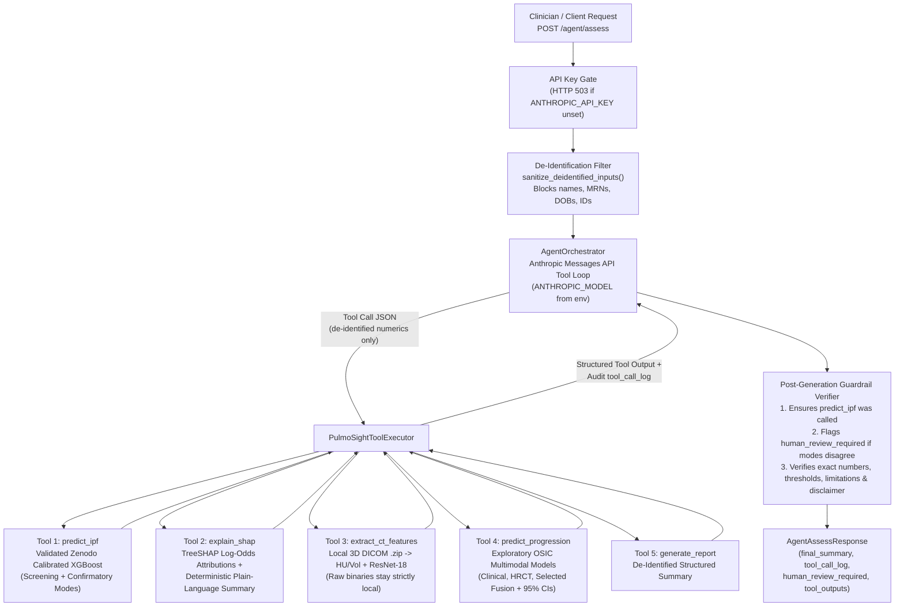

# PulmoSight CDSS — Agentic Framework Design (`backend/agent/`)

> **Status:** Prototype (disabled by default unless `ANTHROPIC_API_KEY` is configured).  
> **Scope:** Tool-calling clinical orchestration layer wrapping existing PulmoSight ML pipelines. The LLM **never generates an independent diagnosis**; it exclusively invokes registered deterministic tools and synthesizes their verified outputs.

---

## 1. Architecture Diagram

---

## 2. Registered Tool Inventory (`backend/agent/tools.py`)

Every tool wraps existing validated PulmoSight backend code rather than duplicating model logic:

| Tool Name | Wrapped Backend Code | Purpose | Output Highlights |
| :--- | :--- | :--- | :--- |
| **`predict_ipf`** | `backend/models/ipf_clinical_pipeline.joblib` (Calibrated XGBoost) | Evaluates patient PFTs & demographics under **both** Screening (`80%` OOF sensitivity) and Confirmatory (`≥92%` OOF specificity) modes. | `ipf_probability`, `screening_threshold`, `confirmatory_threshold`, both predicted labels, `modes_disagree`, `sensitivity_disclosure`, `disclaimer`. |
| **`explain_shap`** | `backend/src/explain.py` (`compute_patient_shap_top_features`, `build_shap_plain_language_summary`) | Computes exact per-patient TreeSHAP contributions on the model's log-odds scale and generates a deterministic plain-language narrative (zero LLM involvement). | `top_5_shap_features`, `shap_plain_summary`, mandatory causal/age caveat. |
| **`extract_ct_features`** | `backend/src/imaging_progression.py` (`extract_features_from_dicom_zip_bytes` / `extract_features_from_upload_bytes`) | Extracts 3D lung HU/volume metrics and pretrained ResNet-18 embeddings locally if a CT series is attached. Raw DICOM binaries never leave the server. | `ct_available`, `hu_mean`, `hu_std`, `haa_pct`, `laa_pct`, `lung_volume_ml`, `num_slices_processed` (or clean HTTP 503/error if `torch` unavailable). |
| **`predict_progression`** | `backend/src/osic_benchmarks.py` (`predict_multimodal_progression`) | Runs the exploratory OSIC longitudinal progression pipelines (predicts FVC decline, **not** IPF diagnosis). Returns `hrct_only: null` and `fusion: null` if no CT series was extracted. | `clinical_only`, `hrct_only`, `fusion` (using `selected_fusion_method`), `modality_used`, CV 95% CIs, `exploratory_banner`. |
| **`generate_report`** | `PulmoSightToolExecutor.tool_generate_report` | Compiles a de-identified structured decision-support report aggregating all executed tool outputs, `human_review_required`, dataset limitations, and the mandatory clinical disclaimer. | Structured JSON report with `deidentified: true`, `limitations`, and `disclaimer`. |

---

## 3. Clinical & Operational Guardrails (`backend/agent/orchestrator.py`)

1. **Disabled by Default (`ANTHROPIC_API_KEY` Gate):**
   - `POST /agent/assess` checks `os.getenv("ANTHROPIC_API_KEY")` at request time and returns **HTTP `503 Service Unavailable`** unless the key is explicitly configured in the deployment environment.
   - The LLM model identifier is read exclusively from `ANTHROPIC_MODEL` (defaulting to `claude-3-5-sonnet-latest`), never hard-coded to an API key or credential file.
2. **No Independent LLM Diagnosis:**
   - The system prompt explicitly prohibits the LLM from inventing a diagnosis, probability, or clinical threshold.
   - If the LLM attempts to respond without calling `predict_ipf`, the orchestrator executes `predict_ipf` deterministically, logs the guardrail intervention in `tool_call_log`, and raises `human_review_required = true`.
3. **Human-Review Escalation on Mode Disagreement:**
   - Because PulmoSight exposes two calibrated operating points — **Screening** (higher sensitivity) and **Confirmatory** (higher specificity) — any patient whose probability falls between the two thresholds (`screening_threshold <= p < confirmatory_threshold`) produces discordant labels (`IPF` in Screening vs. `Non-IPF` in Confirmatory).
   - Whenever `modes_disagree` is `True`, the orchestrator sets `human_review_required = true` and populates `human_review_reasons` explaining the exact threshold discordance so a multidisciplinary ILD board reviews the case.
4. **Post-Generation Verification & Guardrail Appendix:**
   - Before returning `AgentAssessResponse`, the orchestrator checks that `final_summary` contains:
     - the exact calibrated IPF probability returned by `predict_ipf`,
     - both the Screening and Confirmatory operating thresholds,
     - explicit limitations / exploratory progression context, and
     - the verbatim `MANDATORY_DISCLAIMER`.
   - If any mandatory item is absent from the LLM's text, a deterministic **Verified Tool Summary & Guardrail Disclosure** block is appended and `guardrail_appendix_added = true` is flagged in the response.
5. **Structured Tool-Call Audit Log (`tool_call_log`):**
   - Every tool invocation is logged with `step`, `tool_use_id`, `tool_name`, de-identified `inputs`, `status` (`ok`/`error`), `latency_ms`, and exact structured `output`.

---

## 4. Privacy & De-Identification Note

- **Strict Whitelist Enforcement:** `sanitize_deidentified_inputs()` in `backend/agent/tools.py` accepts **only** numeric/categorical physiological variables (`sex`, `age`, `height`, `weight`, `fev1fvc_abs`, `fev1_pp`, `fvc_pp`, `tlc_pp`, `tlco_pp`, `baseline_fvc_ml`, `smoking_status`, `horizon_weeks`, `operating_mode`).
- **Explicit PHI Rejection (HTTP `422`):** Any payload containing keys such as `name`, `patient_name`, `patient_id`, `case_number`, `mrn`, `dob`, `date_of_birth`, `email`, `phone`, `ssn`, `address`, or `free_text` is rejected with **HTTP `422 Unprocessable Entity`** before any Anthropic API call is made.
- **No Raw DICOM Leakage:** When a CT series is attached in a session, raw `.dcm`/`.zip` binaries remain strictly in local memory inside `PulmoSightToolExecutor`; only aggregated scalar HU/volume statistics are returned to the LLM context.
- **Zero PHI in Server Logs:** FastAPI audit middleware logs only method, path, status code, and latency (`PHI_LOGGED=False`).
- **Credential Hygiene:** `ANTHROPIC_API_KEY` is read exclusively from environment variables and is never logged, serialized, returned in API payloads, or committed to disk.

---

## 5. Limitations

1. **Prototype Status (Not Clinically Validated):** The agentic narrative wrapper has been tested with deterministic mocked LLM unit tests (`backend/tests/test_agent.py`), not in a prospective clinical reader study.
2. **External LLM Dependency & Latency:** Enabling `POST /agent/assess` introduces external HTTPS calls to Anthropic's Messages API, adding multi-second latency, API token costs, and network availability dependencies. Core endpoints (`POST /predict-ipf`, `POST /predict-progression-multimodal`, `GET /model-info`) remain 100% local and deterministic without any LLM dependency.
3. **Underlying Dataset & Model Constraints:**
   - The clinical IPF classifier was trained on a single retrospective German ILD center (`Zenodo n=6,808`); external multi-center prospective validation is pending, and screening/confirmatory modes still miss a documented fraction of IPF cases while flagging overlapping fibrotic ILDs (`i-NSIP`, `u-ILD`, `CTD`).
   - All OSIC progression scores (clinical, HRCT, fusion) are strictly exploratory (`n=175` CT patients, separate cohort, no IPF labels) and predict FVC decline, **not** an IPF diagnosis.
4. **Decision Support Only:** Outputs from `POST /agent/assess` are strictly for clinical decision support and research prototyping and must never replace qualified physician judgment or multidisciplinary ILD board evaluation.
